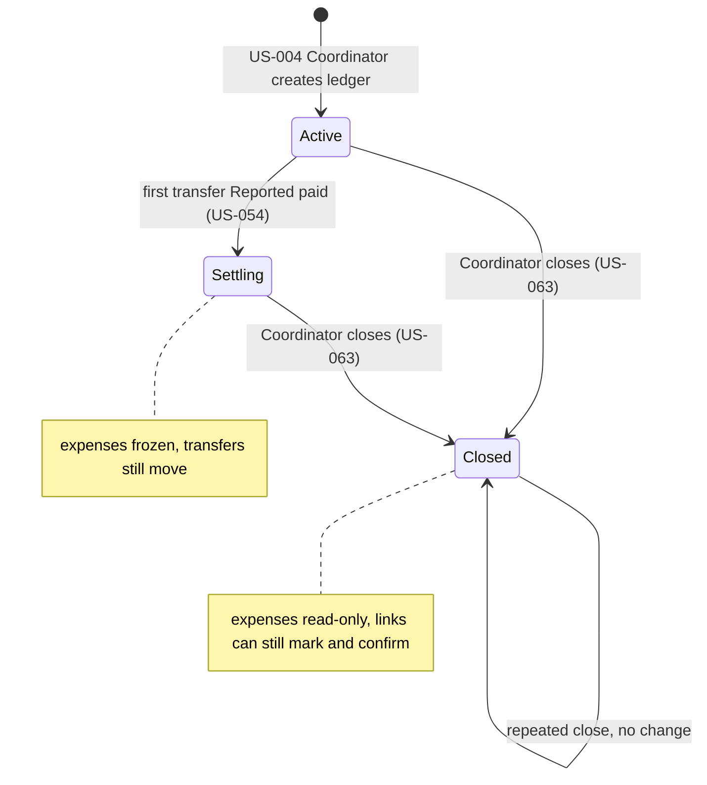
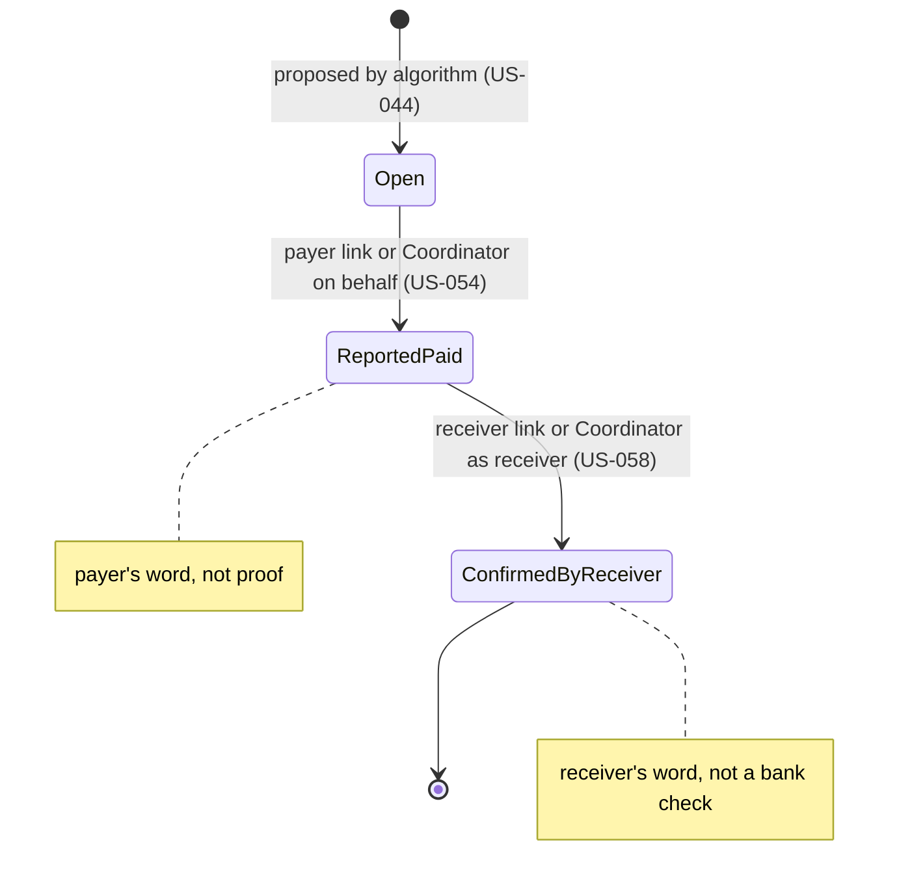

# Babki — Requirements Digest

Technical analysis of `docs/requirements.md` (practice 3) before design. Analysis only: no technologies, no schemas, no endpoints.
Scope: the 21 MVP stories. Binding team decisions: Coordinator signs in with email + password; friends act only through a personal unguessable link; two-sided settlement with forward-only states; deterministic transfer algorithm; no AI, reminders, in-app payments, bank connection or other currencies.

---

## 1. Entities and their states

### 1.1 Entity overview

| # | Entity | Attributes stated in the requirements | Relations | Life cycle |
|---|---|---|---|---|
| E1 | **Coordinator account** | email, password (team decision; no limits stated → G-03) | owns 0..n Ledgers; is linked to one Member in each own Ledger (→ G-04) | none in MVP (no deletion, no reset → G-03) |
| E2 | **Ledger** (trip) | name 1–60 chars, not blank, duplicates allowed (US-004); "Closed" mark (US-063) | 1 Coordinator; 1..20 Members; 0..n Expenses; 0..n Transfers | **yes**, see 1.2 |
| E3 | **Member** | name 1–40 chars, unique in the ledger ignoring case (US-005); **order of addition** (US-019 "Leftover kopecks go to the earliest members"); payment details (US-050) | belongs to 1 Ledger; has 1 Personal link; payer of 0..n Expenses; participant (Share) in 0..n Expenses; from/to of Transfers | none (no removal or rename in the MVP stories → G-05) |
| E4 | **Personal link** | "непідбірне" (unguessable), one per member, opens only that member's page (4.1 "Посилання") | exactly 1 Member | none (no expiry or revocation stated → G-12) |
| E5 | **Expense** | title (used in every scenario, no limits stated → G-10); amount UAH 0.01–999999.99, ≤2 decimals (US-016); exactly one payer who is a member (4.1 "Витрата"); split mode: equal (US-019), amounts (US-020-a), percentages (US-020-b) | 1 Ledger; 1 payer Member; 1..n Shares | no own states; editable only while the Ledger is Active (BR-36, BR-44) |
| E6 | **Share** | amount > 0.00 (4.1 "Гроші"); for US-020-b also the entered percentage | 1 Expense × 1 Member; the Shares of an expense sum exactly to its amount | none |
| E7 | **Transfer** | from Member, to Member, amount; state; who reported it (US-054 "сторінка показує, хто це зробив") | 1 Ledger; payer and receiver Members | **yes**, see 1.3 |
| E8 | **Payment details** | free text up to 100 chars, empty = none (US-050); *proposal*: entered by the Coordinator | attribute of the receiving Member | none |

### 1.2 Ledger

| From | To | Who initiates | Condition | Source |
|---|---|---|---|---|
| — | Active | Coordinator account | valid name (BR-16) | US-004 "Coordinator creates a trip ledger" |
| Active | Settling (expenses frozen) | system | first transfer becomes Reported paid | US-054 "Expenses are frozen after the first mark" |
| Active | Closed | Coordinator account | always allowed, also with Open transfers or with no transfers | US-063 "The trip is closed with unconfirmed transfers", checklist "Ledger без переказів можна закрити" |
| Settling | Closed | Coordinator account | always allowed | US-063 "All transfers confirmed, then the trip is closed" |
| Closed | Closed | Coordinator account | repeat → no change | US-063 checklist "Повторне закриття нічого не змінює" |

"Settling" is not named in the requirements; it is the state introduced by the freeze rule (4.1 "Заморожування й закриття"). "Fully settled" is **not a state**: it is a derived label shown on a Closed ledger when every transfer is Confirmed and at least one transfer exists (BR-46).

### 1.3 Transfer

| From | To | Who initiates | Condition | Source |
|---|---|---|---|---|
| — | Open | system | proposed by the algorithm; every transfer starts Open | US-044 checklist "кожен переказ починається як Open" |
| Open | Reported paid | payer's link, **or** Coordinator account on the payer's behalf | only the transfer's own payer; the page records who reported | US-054 "Max reports that he paid Olia"; e2e "Only the Coordinator uses Babki…" |
| Reported paid | Confirmed by receiver | receiver's link, **or** Coordinator account only if the Coordinator is the receiver | not from Open; not by the payer | US-058 "Olia confirms Max's payment", "An Open transfer cannot be confirmed", "A payer cannot confirm their own transfer" |
| Reported paid | Reported paid | same actors | repeat → no change, no duplicate | US-054 checklist |
| Confirmed | Confirmed | same actors | repeat → no change; never rolls back | US-058 checklist |

Both transitions remain allowed after the ledger is Closed (US-063 checklist "Після закриття посилання все ще дозволяють позначати й підтверджувати").

### 1.4 Stored vs derived

| Value | Stored or derived | Recalculated when | Source |
|---|---|---|---|
| Ledgers, members (with order), links, payment details, expenses, shares | stored | — | US-004, US-005, US-016–US-020-b, US-050 |
| Member balance (paid − shares) | **derived** | an expense is added or edited | 4.1 "Баланс учасника = сплатив мінус його частки" |
| Proposed transfer list | **derived** while the ledger is Active | an expense is added or edited; "immediately, without extra steps" | US-048 "Correcting an amount updates the transfers at once" |
| Transfer state and "reported by" | **stored** — must survive; see G-01 for when the list stops being derived | a mark or confirm action | US-054, US-058 |
| "Settling" (frozen) flag | derived: any transfer ≥ Reported paid | a mark action | US-054 |
| "Fully settled", "Not confirmed" group, Open / Reported / Confirmed groups | derived for display | any transfer state change, closing | US-060-a, US-060-b, US-063 |
| Member breakdown (paid, shares, totals) | derived | an expense is added or edited | US-030 "Max checks his amount" |

---

## 2. Business rules and invariants

Types: **V** validation · **I** invariant · **P** permission · **S** state.

**Money**

| ID | Rule | Type | Source |
|---|---|---|---|
| BR-01 | An amount is UAH, 0.01–999999.99, at most two decimals, dot as separator; 0, negative, >999999.99, non-numbers, "1,50" and "1.234" are refused. | V | US-016 "An invalid amount is refused"; 4.1 "Гроші" |
| BR-02 | The shares of an expense always add up **exactly** to its amount. | I | 4.1 "Частки завжди дають у сумі точно суму витрати"; US-019 checklist |
| BR-03 | Every share is greater than 0.00. | I | 4.1; US-020-b "Поділ, що дав би комусь частку 0.00, відхиляється" |
| BR-04 | Balance = paid − shares; the balances of a ledger always sum to 0.00. | I | 4.1; US-018 checklist |
| BR-05 | Equal split is done in kopecks; leftover kopecks go one each to participants in the order they were **added to the ledger**, not the order they were selected. | I | US-019 "Leftover kopecks go to the earliest members" |
| BR-06 | An equal split that cannot give each participant at least 0.01 is refused; exactly 0.01 each is accepted. | V | US-019 "An amount too small is refused" |
| BR-07 | Split by amounts: each amount > 0, ≤2 decimals; the sum must equal the expense, otherwise the expense is refused and the difference is shown. | V | US-020-a "Amounts that do not add up are refused with the difference" |
| BR-08 | Split by percentages: each 0 < p ≤ 100, ≤2 decimals; the sum must be exactly 100.00, otherwise refused with the difference in points. | V | US-020-b "Percentages that do not add up to 100 are refused" |
| BR-09 | Percentages are converted to kopecks; the leftover kopeck goes by ledger order. | I | US-020-b "A leftover kopeck goes to the earlier member" |

**Expenses**

| ID | Rule | Type | Source |
|---|---|---|---|
| BR-10 | Exactly one payer, and the payer is a member of this ledger. | V | US-017 "A payer who is not in the ledger is refused" |
| BR-11 | At least one participant; every participant is a member of this ledger. | V | US-016 "An expense without participants is refused"; US-018 "A person outside the ledger cannot be a participant" |
| BR-12 | The payer may or may not be among the participants. | I | US-017 "A friend paid but does not share the expense" |
| BR-13 | Invalid input is refused **entirely**: nothing is saved and nothing changes. | I | 4.1 "Невалідні дані відхиляються повністю"; US-016 outline "all balances are unchanged" |
| BR-14 | Editing changes amount, payer or participants of the same expense (one expense, not two) and applies the same validations; a refused edit leaves the expense as it was. | V/I | US-031 "The amount is corrected", "Removing every participant is refused" |
| BR-15 | No limit on the number of expenses and no price; no text about a limit, price, upgrade or free counter is ever shown. | I | US-021 "500 expenses are recorded and the 501st works too", "No limit, price or counter is ever shown" |

**Ledger and members**

| ID | Rule | Type | Source |
|---|---|---|---|
| BR-16 | Ledger name 1–60 characters; empty, spaces only or 61 characters are refused. | V | US-004 "A blank or too long name is refused" |
| BR-17 | Two ledgers may have the same name and stay independent. | I | US-004 checklist |
| BR-18 | A new ledger has 0 expenses, all balances 0.00, and its creator is its Coordinator. | S | US-004 "Coordinator creates a trip ledger" |
| BR-19 | Member name 1–40 characters, unique in the ledger ignoring case ("Max" = "MAX" = "max"). | V | US-005 "A duplicate name is refused" |
| BR-20 | At most 20 members; the 21st is refused (but see G-06). | V | US-005 checklist |
| BR-21 | Only the Coordinator adds members; no account is needed for a member. | P | US-005 checklist |
| BR-22 | A member who never opened a link is fully counted in shares and balances; the ledger works if nobody opens a link. | I | US-005 "A friend who never opened a link is included in calculations"; US-007 "The ledger works when nobody opens an invitation" |

**Transfers**

| ID | Rule | Type | Source |
|---|---|---|---|
| BR-23 | The same set of expenses always gives the same transfer list, whatever the order of entry. | I | US-044 "The same expenses in a different order give the same list" |
| BR-24 | Executing all transfers brings every balance to 0.00; a zero-balance member appears in no transfer; number of transfers ≤ (members with non-zero balance − 1). | I | US-044 checklist; 4.1 "Перекази" |
| BR-25 | Mutual debts are netted: only the difference is paid. | I | US-044 "Debts that cancel out are netted" |
| BR-26 | After a valid change the list is recalculated at once; a stale list is never shown as current; reverting an expense restores the old list; a refused change does not change the list. | I | US-048 "Correcting an amount updates the transfers at once", "A refused edit does not change the list" |
| BR-27 | The list is called "proposed" and never claims to be the mathematical minimum; an empty ledger or all-zero balances show "no transfers needed". | I | US-044 checklist; 4.1 |
| BR-28 | Every proposed transfer starts Open. | S | US-044 |
| BR-29 | Open → Reported paid only by the transfer's payer (own link) or by the Coordinator on the payer's behalf; the page shows who reported. | S/P | US-054 "Max reports that he paid Olia"; e2e "Only the Coordinator uses Babki and the trip is still fully settled" |
| BR-30 | Reported paid → Confirmed by receiver only by the receiver (own link), or by the Coordinator when the Coordinator is the receiver. | S/P | US-058 "Olia confirms Max's payment" |
| BR-31 | An Open transfer cannot be confirmed; a Confirmed transfer never rolls back; states only move forward. | S | US-058 "An Open transfer cannot be confirmed"; 4.1 "Стани переказу (тільки вперед)" |
| BR-32 | A payer cannot confirm their own transfer; the Coordinator cannot confirm a transfer that someone else receives. | P | US-058 "A payer cannot confirm their own transfer"; US-058 checklist |
| BR-33 | A link acts only on its own member's transfers (own outgoing: mark; own incoming: confirm). | P | US-007 "One member's link cannot act for another"; US-054 "A payer cannot mark someone else's transfer" |
| BR-34 | Repeating a mark, a confirm or a close changes nothing and creates no duplicate. | I | US-054, US-058, US-063 checklists; 4.5 "Повторні дії нічого не змінюють" |
| BR-35 | Marking or confirming never changes amounts or balances. | I | US-054, US-058 checklists |
| BR-36 | **Freeze:** once any transfer is Reported paid or Confirmed, adding or editing an expense is refused with the explanation that settlement has started. | S | US-054 "Expenses are frozen after the first mark"; US-016, US-017, US-031 checklists |
| BR-37 | Coordinator overview: Open transfers listed (payer, receiver, amount); Reported paid and Confirmed in two separate groups; Open + Reported + Confirmed = all transfers; empty groups show an empty-state text ("everyone has reported paying", "no transfers needed"). | I | US-060-a "Reported and confirmed transfers leave the list", "Everyone has reported paying"; US-060-b "Three transfers in three states" |

**Personal link and member page**

| ID | Rule | Type | Source |
|---|---|---|---|
| BR-38 | A link opens only its member's page, without login, registration or installation. | P | US-009 "Max opens his personal link on a phone" |
| BR-39 | The link cannot add, edit or delete expenses, members or payment details, and cannot close the trip. | P | 4.1 "Посилання"; US-016, US-031 checklists; US-063 "A personal link cannot close the trip" |
| BR-40 | The member page shows only own data: what to pay (amount, to whom), what to receive (amount, from whom), and the breakdown; never other members' transfers, shares, balances or details. | P | US-009 "Iryna sees only her own transfer"; US-030 checklist |
| BR-41 | An unknown or damaged link shows a neutral "link not found" with no ledger or member name. | I | US-009 "An unknown link shows a neutral message" |
| BR-42 | Breakdown: one row per expense the member paid or shares (title, paid, share); totals paid, shares, balance; \|balance\| equals the sum of the member's transfers; "no expenses yet" when empty. | I | US-030 "Max checks his amount", "A receiver's balance equals what she should receive" |
| BR-43 | Payment details: free text ≤100 characters (101 refused, empty = none); the payer sees the receiver's details on each outgoing transfer and copies them exactly; without details copying is unavailable and the payer is told to ask the Coordinator; a receive-only member sees no one's details; copying never changes a state. | V/P | US-050 "Iryna copies Olia's details", "Missing details cannot be copied" |

**Closing and wording**

| ID | Rule | Type | Source |
|---|---|---|---|
| BR-44 | Only the Coordinator closes; a Closed ledger refuses adding and editing expenses. | S/P | US-063 "A closed ledger refuses expense changes", "A personal link cannot close the trip" |
| BR-45 | After closing, links can still mark and confirm transfers. | S | US-063 checklist |
| BR-46 | "Fully settled" appears only when the ledger has transfers and all are Confirmed; otherwise unconfirmed transfers are grouped under "Not confirmed" with their state, and nothing suggests everyone settled. A ledger with no transfers shows "Closed" and "no transfers needed", not "fully settled". | I | US-063 "All transfers confirmed…", "The trip is closed with unconfirmed transfers"; US-063 checklist |
| BR-47 | No text says "verified", "verified by bank", "received" (for a payer's report) or "paid via Babki". | I | 4.1 "Жоден текст не каже…"; US-054, US-058, US-060-b scenarios |

### Forbidden actions

| The system must never… | Rule |
|---|---|
| save an expense whose shares do not sum exactly to its amount, or with a 0.00 share | BR-02, BR-03 |
| save a part of an invalid input | BR-13 |
| let one member's link act on another member's transfer | BR-33 |
| let a link change expenses, members, details or close the trip | BR-39 |
| show another member's balances, shares or details on a member page | BR-40 |
| reveal a ledger or member name for an unknown link | BR-41 |
| confirm an Open transfer, let a payer confirm their own transfer, or move a state backwards | BR-31, BR-32 |
| add or edit expenses after the first Reported paid or after closing | BR-36, BR-44 |
| create duplicates on repeated actions | BR-34 |
| show a stale transfer list as current | BR-26 |
| show "fully settled" while any transfer is not Confirmed | BR-46 |
| claim the money was verified or paid through Babki | BR-47 |
| refuse an expense because of how many exist, or mention a limit or price | BR-15 |

---

## 3. Non-functional requirements implied by the text

| ID | Requirement | Why it follows (citation) | How to check |
|---|---|---|---|
| NFR-01 | Personal link tokens cannot be guessed or enumerated, and do not reveal internal identifiers. | 4.1 "Кожен учасник має своє непідбірне посилання"; 2.2 risk 5 "воно має бути хоча б непідбірним" | US-009 outline: a valid link with its last character removed → "link not found"; tokens are not sequential |
| NFR-02 | Coordinator actions require a signed-in account; passwords are stored in a non-reversible form. | team decision email + password; BR-21, BR-39 | every Coordinator action without a session is refused; no plain password in storage |
| NFR-03 | The member page is reachable without authentication and shows exactly one member's data. | US-009 "no login or installation is asked"; BR-40 | Iryna's page contains none of 362.13, 1352.62 or others' balances (US-009 scenario) |
| NFR-04 | Ledgers are isolated: a Coordinator sees only own ledgers; a link never reaches another ledger. | US-004 "окремо від інших", "лишаються окремими" | two ledgers with the same name; actions in one never appear in the other |
| NFR-05 | Deterministic calculation: same expenses → same shares and same transfer list, on every run and every machine. | US-044 "…in a different order give the same list"; US-019 rounding by ledger order | run the "Carpathians" data in two orders; compare lists |
| NFR-06 | Exact money arithmetic: no floating-point error anywhere in shares, balances, transfers. | 4.1 "точно суму витрати", "Усі баланси разом = 0.00" | sum checks on all 4.2 example rows and the 500-expense test |
| NFR-07 | Atomic changes: an expense with its shares is saved completely or not at all. | BR-13 | a failing validation leaves balances identical (US-016 outline) |
| NFR-08 | Concurrency: a mark/confirm and an expense edit arriving at the same time must not both succeed in a way that breaks the freeze; double clicks must not create duplicates or skip states. | BR-36 freeze + BR-34 idempotency; the Coordinator and friends act from different devices (1.2 step 5) | parallel "edit expense" + "mark paid" → exactly one wins and the other is refused with an explanation |
| NFR-09 | Derived data is never stale: balances and the transfer list reflect the last saved expense. | US-048 "Старий список ніколи не показується як поточний" | edit an amount, reload any page: new values |
| NFR-10 | Mobile: works in a mobile browser at 360 px width without horizontal scroll, no installation. | 4.1 "Загальне"; US-007, US-009 checklists | 360 px viewport check of every page |
| NFR-11 | Ukrainian interface. | 4.1 "інтерфейс українською"; US-009 "in Ukrainian" | all user-visible texts in Ukrainian (see G-21) |
| NFR-12 | Volume: 500 expenses and 20 members per ledger stay correct and usable. | US-021; 4.1 "перевірено до 500 витрат і 20 учасників" | US-021 scenario with 501 expenses; balances +2505.00 / −2505.00 |
| NFR-13 | No payments, bank connection or reminders anywhere. | 4.1 "немає оплати в застосунку, підключення банку чи надсилання нагадувань" | no outgoing integration except what auth needs (G-03) |

---

## 4. Gaps and open questions

**B** = must be answered before architecture decisions; **W** = can wait until implementation.

| ID | Gap | Why it blocks | Cheapest answer for the MVP | When |
|---|---|---|---|---|
| G-01 | Transfers are **derived** (recalculated on every change, US-048) but also have a **stored state** (US-054, US-058). The requirements never say when a transfer becomes a persistent record. | data model of Transfer; what US-048 recalculation may overwrite | derive the list while the ledger is Active; at the first "Reported paid" save the current list once and use it from then on. The freeze (BR-36) guarantees the list cannot change afterwards. | **B** |
| G-02 | Who enters payment details of a receiver who is not the Coordinator (1.3 q2; 4.5 q1; US-050 "*Пропозиція*"). | permissions of the link vs account; whether a link can write anything besides states | the Coordinator enters and edits details for any member; links never write details (consistent with BR-39) | **B** |
| G-03 | Account life cycle is unspecified: registration fields, password rules, email verification, password reset, sign-out. | authentication decision; an email-sending dependency if reset or verification is needed | sign up (email + password, minimum length), sign in, sign out. No email verification and no reset in the MVP | **B** |
| G-04 | The Coordinator is also a member (Olia pays and receives in every example), but it is not said how the account relates to the member record or whether the Coordinator has a personal link. | Member ↔ Account relation; BR-30 "Coordinator as receiver" | creating a ledger automatically creates the Coordinator's member record as the first member, tied to the account. The Coordinator acts through the account; a personal link for them may exist but is not needed | **B** |
| G-05 | No story covers deleting an expense, removing or renaming a member. A typo in a member's name cannot be fixed. | which data changes exist; what recalculation must handle | no deletion and no renaming in the MVP; corrections only via US-031 | W |
| G-06 | **Contradiction:** US-005 says the 21st member "відхиляється (максимум 20)", while 4.1 says 500 / 20 are "тестові межі, не обіцянка". | validation rule and the volume target | treat 20 as a hard limit (US-005 is more specific) | **B** |
| G-07 | A mistaken "Reported paid" cannot be undone and freezes all corrections (4.5 q2). | product risk, not structure | accept for the MVP; document as a known limitation | W |
| G-08 | Several equally good transfer lists can exist; which one is shown (4.5 q4)? | determinism (BR-23) and test expectations for US-044 | fix a deterministic tie-break by ledger order of members; the "Carpathians" result must stay as in 4.2 | **B** (for the settlement decision) |
| G-09 | After closing, may the **Coordinator** still mark on behalf or confirm? US-063 mentions only links. | permission matrix after Close | yes, the same actions as before closing | W |
| G-10 | Expense title: required? length? Every scenario has one, no rule exists. | validation | required, 1–60 characters like the ledger name | W |
| G-11 | No expense date or time is mentioned. | data fields | store only creation time, not shown | W |
| G-12 | A leaked link cannot be revoked or replaced. | link model | no revocation in the MVP; accepted risk (financial data of one member) | W |
| G-13 | One Coordinator per ledger or several; what happens if the account is lost (no reset, G-03). | ownership model | one Coordinator per ledger, no transfer of ownership; a lost password means a lost ledger (accepted for MVP) | **B** (with G-03) |
| G-14 | US-031 edits an expense split by percentages: are the entered percentages kept to show in the edit form, or only the resulting shares? | Share attributes | store the split mode and the entered values next to the computed shares | W |
| G-15 | **Contradiction:** the UI must be Ukrainian (4.1, US-009 "in Ukrainian"), but scenarios quote English UI texts ("link not found", "fully settled", "Not confirmed"). | texts in tests vs UI | treat quoted strings as message identifiers; the UI shows Ukrainian equivalents; tests check by identifier | W |
| G-16 | Can members be added or payment details changed after the freeze or after closing? The freeze speaks only of expenses. | permission matrix | members: refused after the freeze (they would have no shares anyway); details: editable at any time, because they are needed to pay | W |
| G-17 | US-009 and US-030 overlap (end of section 3). | page structure only | one member page with the amount and the breakdown | W |
| G-18 | Is manual reminding in the chat enough (1.3 q3)? Will one Coordinator really keep the whole trip (1.3 q4)? Minimum transfers vs paying the original payer (1.3 q5)? | product validation, not design | out of design scope; verify in interviews | W |

Already answered by the requirements or team decisions (listed so they are not reopened): personal links vs one shared link (team decision 2; 4.5 q3); whether a link may mark (yes, own outgoing — 1.3 q1, BR-29); closing as a separate action (yes — US-063; 4.5 q6); closing a ledger without transfers (allowed, no "fully settled" — US-063; 4.5 q5); edits after "paid" (refused — BR-36).

---

## 5. Assumptions for the MVP

| ID | Assumption | Unblocks | Risk if wrong |
|---|---|---|---|
| A-01 | Internal identifiers are never exposed in links; each member link is a separate random token. | NFR-01, data model | **high** — sequential or derived tokens would expose other members' finances |
| A-02 | Money is handled as whole kopecks everywhere and formatted with two decimals only for display. | BR-02…BR-09, NFR-06 | low — becomes wrong only with other currencies, which are out of scope |
| A-03 | One currency, UAH. | money rules | low — US-024 is Out of Scope |
| A-04 | One Coordinator per ledger: the account that created it (G-13). | ownership, permissions | medium — a second organiser in a group would have to share one account |
| A-05 | The Coordinator is automatically the first member of each own ledger (G-04). | kopeck order (Olia first in 4.2), BR-30 | medium — if the Coordinator should not be a participant, shares need an opt-out |
| A-06 | Transfers are derived until the first "Reported paid", then saved once and never recalculated (G-01). | Transfer model, BR-26 vs BR-29 | medium — if edits after "paid" become allowed later, saved states must be remapped |
| A-07 | The Coordinator enters payment details for all members (G-02). | BR-43, link permissions | low — easy to add later |
| A-08 | Accounts: sign up, sign in, sign out only; no email verification, no password reset (G-03). | auth decision, no email dependency | medium — a forgotten password loses access to the ledger |
| A-09 | A session stays valid on the device for days so the Coordinator is not signed out during a trip. | auth decision | low |
| A-10 | Timestamps are stored in UTC and shown in Kyiv time. | data fields | low |
| A-11 | 20 members is a hard limit (G-06). | validation, volume | low |
| A-12 | No deletion or renaming of expenses and members; only US-031 edits (G-05). | data changes, recalculation scope | medium — typos in member names stay visible |
| A-13 | Links never expire and cannot be revoked (G-12). | link model | medium — a forwarded link exposes one member's data for good |
| A-14 | Expense title is required, 1–60 characters (G-10). | validation | low |
| A-15 | Quoted English UI strings are message identifiers; the UI is Ukrainian (G-15). | tests, UI texts | low |
| A-16 | Ties between equally good transfer lists are broken by ledger order of members (G-08). | BR-23 determinism | low — must still reproduce the 4.2 result |
| A-17 | Percent split: each share is rounded down to whole kopecks, leftover kopecks go by ledger order (matches US-020-b "A leftover kopeck goes to the earlier member"). | BR-09 | low |
| A-18 | After closing, the Coordinator keeps the same transfer actions as before (G-09). | permissions after Close | low |

---

## 6. Traceability check

| Story | Entities | Rules |
|---|---|---|
| US-004 | Account, Ledger | BR-16, BR-17, BR-18 |
| US-005 | Ledger, Member | BR-19, BR-20, BR-21, BR-22 |
| US-007 | Member, Personal link | BR-22, BR-33, BR-38 |
| US-016 | Expense, Share | BR-01, BR-11, BR-13, BR-36, BR-39 |
| US-017 | Expense, Member | BR-10, BR-12, BR-36 |
| US-018 | Expense, Share, Member | BR-04, BR-11 |
| US-019 | Share | BR-02, BR-05, BR-06 |
| US-020-a | Share | BR-02, BR-03, BR-07 |
| US-020-b | Share | BR-03, BR-08, BR-09 |
| US-021 | Expense | BR-15 |
| US-031 | Expense, Share | BR-14, BR-36, BR-39 |
| US-044 | Transfer (derived) | BR-23, BR-24, BR-25, BR-27, BR-28 |
| US-048 | Transfer (derived) | BR-26 |
| US-009 | Personal link, Member | BR-38, BR-40, BR-41 |
| US-030 | Member, Expense, Share | BR-40, BR-42 |
| US-050 | Payment details, Transfer | BR-43 |
| US-054 | Transfer, Ledger | BR-29, BR-33, BR-34, BR-35, BR-36, BR-47 |
| US-058 | Transfer | BR-30, BR-31, BR-32, BR-34, BR-35, BR-47 |
| US-060-a | Transfer | BR-37 |
| US-060-b | Transfer | BR-37, BR-47 |
| US-063 | Ledger, Transfer | BR-34, BR-44, BR-45, BR-46 |

Every story produced at least one rule; every rule traces to a story or to the shared rules in 4.1. Rules that come only from the shared rules and not from a story checklist: BR-04 (balances sum to 0.00 is also asserted in US-018) and BR-47 (also asserted in US-054, US-058, US-060-b) — none are orphaned.
