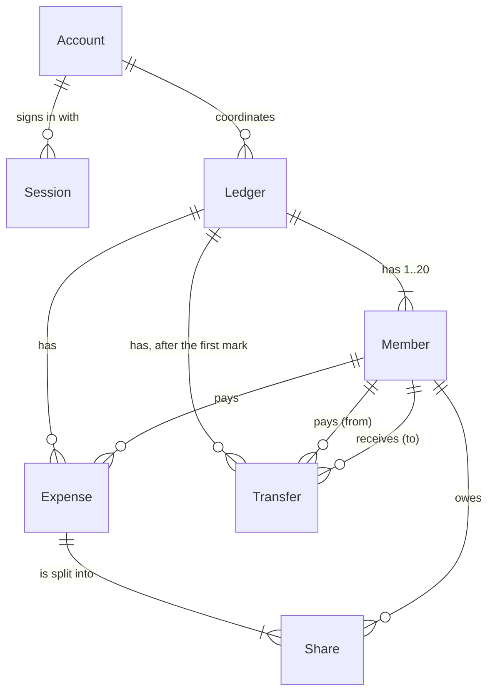

# Babki — Technical Contracts

Built on [`docs/requirements-digest.md`](requirements-digest.md) (BR-xx, NFR-xx, G-xx, A-xx) and [`docs/adr/`](adr/README.md) (ADR-0001…0006). Scope: the 21 MVP stories. Contracts only: no application code, no schema file, no SQL.
Identifiers in JSON examples (`led_carp`, `mem_olia`, …) are readable placeholders; real IDs are generated by the server. All numbers come from the "Carpathians" data of requirements 4.2.

---

## 1. Data schema

Tables are named like Prisma models (PascalCase models, camelCase fields) so the skeleton copies them as they are. Types are Prisma scalar types. `Int` in Prisma is a 32-bit signed integer, so `Transfer.amountKopecks` is `BigInt` (CD-14); the API still carries plain numbers.



Enums: `SplitMode` = `EQUAL` · `AMOUNTS` · `PERCENTAGES`; `TransferState` = `OPEN` · `REPORTED_PAID` · `CONFIRMED`; `ReportedVia` = `PAYER_LINK` · `COORDINATOR`; `ConfirmedVia` = `RECEIVER_LINK` · `COORDINATOR`.

### 1.1 Account — the Coordinator's account (E1)

| Field | Type | Required | Constraint | Source |
|---|---|---|---|---|
| id | String | yes | primary key, generated (`cuid()`) | A-01 |
| email | String | yes | **unique**; stored trimmed and lower-cased; valid e-mail, ≤ 254 characters | team decision 1, ADR-0005 |
| passwordHash | String | yes | argon2id (or bcrypt) hash, never the password | NFR-02, ADR-0005 |
| createdAt | DateTime | yes | default now, UTC | A-10 |

### 1.2 Session — a signed-in device

| Field | Type | Required | Constraint | Source |
|---|---|---|---|---|
| id | String | yes | primary key; random 256-bit value, base64url; it is the cookie value | ADR-0005 |
| accountId | String | yes | foreign key → Account, **on delete cascade** | ADR-0005 |
| createdAt | DateTime | yes | default now | — |
| expiresAt | DateTime | yes | now + 30 days, moved forward on use | A-09, ADR-0005 |

### 1.3 Ledger — a trip (E2)

| Field | Type | Required | Constraint | Source |
|---|---|---|---|---|
| id | String | yes | primary key, generated | A-01 |
| name | String | yes | trimmed, 1–60 characters; **not unique** | BR-16, BR-17 |
| coordinatorId | String | yes | foreign key → Account, **on delete restrict**; index | A-04, NFR-04 |
| closedAt | DateTime | no | `NULL` = open; set once, never cleared | BR-44, US-063 |
| createdAt | DateTime | yes | default now | A-10 |

There is no stored "state". `ACTIVE` / `SETTLING` / `CLOSED` is derived (1.8).

### 1.4 Member — a person in a ledger (E3, E4, E8)

| Field | Type | Required | Constraint | Source |
|---|---|---|---|---|
| id | String | yes | primary key, generated | A-01 |
| ledgerId | String | yes | foreign key → Ledger, on delete cascade | US-005 |
| name | String | yes | trimmed, 1–40 characters, shown as typed | BR-19 |
| nameKey | String | yes | `name` lower-cased (Unicode); **unique together with `ledgerId`** | BR-19, ADR-0004 |
| position | Int | yes | 1–20 (check); **unique together with `ledgerId`**; order of addition, 1 = the Coordinator | BR-05, BR-09, BR-20, A-05 |
| isCoordinator | Boolean | yes | default false; exactly one `true` per ledger, set when the ledger is created | G-04, A-05 |
| paymentDetails | String | no | ≤ 100 characters; empty input is stored as `NULL` | BR-43, A-07 |
| linkToken | String | yes | **unique**; 22 base64url characters (128 random bits); never derived from IDs; never changes | NFR-01, A-01, A-13, ADR-0005 |
| createdAt | DateTime | yes | default now | A-10 |

The token lives on `Member` because the link is strictly 1:1 with a member and has no expiry or revocation in the MVP (A-13, G-12). A separate table is needed only if revocation is added.
The Coordinator's own member has a token like everyone else; it behaves as any member link (it cannot do Coordinator actions, BR-39).

### 1.5 Expense (E5)

| Field | Type | Required | Constraint | Source |
|---|---|---|---|---|
| id | String | yes | primary key, generated | A-01 |
| ledgerId | String | yes | foreign key → Ledger, on delete cascade; index with `createdAt` | US-016 |
| title | String | yes | trimmed, 1–60 characters | A-14 |
| amountKopecks | Int | yes | check 1 … 99 999 999 | BR-01, A-02 |
| payerId | String | yes | foreign key → Member, **on delete restrict** | BR-10 |
| splitMode | SplitMode | yes | — | US-019, US-020-a, US-020-b |
| clientRequestId | String | no | 1–64 characters, generated by the client for one submission; **unique together with `ledgerId`** (several `NULL`s allowed); lets a repeated "add expense" return the saved expense instead of creating a duplicate | CD-11, BR-34 |
| createdAt | DateTime | yes | default now; defines the order of expenses | A-10, G-11 |
| updatedAt | DateTime | yes | set on every edit | US-031 |

### 1.6 Share (E6)

| Field | Type | Required | Constraint | Source |
|---|---|---|---|---|
| expenseId | String | yes | foreign key → Expense, on delete cascade | BR-11 |
| memberId | String | yes | foreign key → Member, on delete restrict | BR-11 |
| amountKopecks | Int | yes | check ≥ 1 | BR-03 |
| percentBp | Int | no | check 1 … 10 000 (hundredths of a percent: 50 % = 5000); set only when `splitMode` is `PERCENTAGES` | BR-08, G-14 |

Primary key (`expenseId`, `memberId`): one share per member per expense. Editing an expense replaces all its shares in one transaction.

### 1.7 Transfer (E7)

Rows exist only after the first "Reported paid" (A-06, G-01); before that the list is computed (1.8).

| Field | Type | Required | Constraint | Source |
|---|---|---|---|---|
| id | String | yes | primary key, generated | A-01 |
| ledgerId | String | yes | foreign key → Ledger, on delete cascade | BR-24 |
| fromMemberId | String | yes | foreign key → Member, on delete restrict | BR-24 |
| toMemberId | String | yes | foreign key → Member, on delete restrict; check `toMemberId <> fromMemberId` | BR-24 |
| amountKopecks | BigInt | yes | check ≥ 1; 64-bit because a transfer may exceed 2 147 483 647 kopecks (CD-14); converted to a plain number in the data layer | BR-24 |
| state | TransferState | yes | default `OPEN`; moves only forward | BR-28, BR-31 |
| reportedVia | ReportedVia | no | set with the first move to `REPORTED_PAID`; shows who made the report | BR-29, US-054 |
| reportedAt | DateTime | no | set with `reportedVia` | A-10 |
| confirmedVia | ConfirmedVia | no | set with the move to `CONFIRMED` | BR-30 |
| confirmedAt | DateTime | no | set with `confirmedVia` | A-10 |
| createdAt | DateTime | yes | default now (the moment of the first mark) | — |

**Unique** (`ledgerId`, `fromMemberId`, `toMemberId`): the matching algorithm settles at least one side completely at every step (ADR-0006), so the same pair never occurs twice. If the algorithm changes, revisit this constraint.

### 1.8 Stored and derived values

| Value | Stored or derived | Recalculated when |
|---|---|---|
| Account, session, ledger, member, expense, share, transfer rows | stored | written by their endpoints |
| Share `amountKopecks` | stored (computed once on save from the split mode) | the expense is saved or edited |
| Member balance (paid − shares) | **derived, never stored** | every read |
| Proposed transfer list | **derived** while no `Transfer` row exists for the ledger | every read; changes with every expense change |
| Transfer list after the first mark | stored, frozen | never |
| Ledger `state`: `CLOSED` if `closedAt` is set, else `SETTLING` if any `Transfer` row exists, else `ACTIVE` | **derived** | every read |
| `fullySettled`: `closedAt` set **and** at least one transfer **and** all `CONFIRMED` | **derived** | every read |
| Groups "Open", "Reported paid", "Confirmed", "Not confirmed" | derived by filtering `transfers[]` on the client | every read |
| Member breakdown (paid, shares, balance) | derived | every read |

### 1.9 What the database holds and what a service must hold

| Held by the database | How |
|---|---|
| unique e-mail, unique link token, unique member name per ledger (via `nameKey`), unique member position per ledger, unique transfer pair per ledger, one share per member per expense, unique `clientRequestId` per ledger | unique constraints / primary keys |
| at most 20 members per ledger | check `position` 1–20 together with unique (`ledgerId`, `position`) |
| amounts, percentages and positions in range; no transfer to oneself | check constraints, written by hand into the initial migration SQL (Prisma does not model them) |
| every reference points to an existing row | foreign keys |

| Not held by the database | Enforced by | Source |
|---|---|---|
| shares of an expense sum exactly to its amount; no share is 0 | `ExpenseService`, before the write, in the same transaction | BR-02, BR-03 |
| payer and participants belong to the ledger of the expense | `ExpenseService` | BR-10, BR-11 |
| `percentBp` is present exactly when the split mode is `PERCENTAGES` | `ExpenseService` | G-14 |
| exactly one Coordinator member per ledger | `LedgerService`, in the transaction that creates the ledger | A-05 |
| freeze: no expense or member write when any `Transfer` row exists; no expense write when `closedAt` is set | `ExpenseService`, `MemberService`, checked inside the writing transaction | BR-36, BR-44, ADR-0006 |
| forward-only transfer states, repeat = no change | `TransferService`, conditional update | BR-31, BR-34 |
| the saved transfers equal the computed list at the first mark; all saved or none | `TransferService`, one transaction | A-06 |
| `reportedVia`/`confirmedVia` are set exactly with the matching state | `TransferService` | BR-29, BR-30 |

### 1.10 The "Carpathians" example as rows

Members: `Olia` (position 1, Coordinator), `Max` (2), `Iryna` (3), `Andrii` (4).

**Expense**

| # | title | amountKopecks | payer | splitMode |
|---|---|---|---|---|
| E1 | House rent | 600000 | Olia | EQUAL |
| E2 | Groceries | 185050 | Max | EQUAL |
| E3 | Taxi | 42000 | Iryna | EQUAL |
| E4 | Funicular | 90000 | Andrii | AMOUNTS |

**Share** (amountKopecks)

| Expense | Olia | Max | Iryna | Andrii | Sum | = amount |
|---|---|---|---|---|---|---|
| E1 | 150000 | 150000 | 150000 | 150000 | 600000 | yes |
| E2 | 46263 | 46263 | 46262 | 46262 | 185050 | yes |
| E3 | 14000 | — | 14000 | 14000 | 42000 | yes |
| E4 | 25000 | 25000 | 25000 | 15000 | 90000 | yes |

Derived balances: Olia 600000 − 235263 = **+364737**; Max 185050 − 221263 = **−36213**; Iryna 42000 − 235262 = **−193262**; Andrii 90000 − 225262 = **−135262**; sum 0.
Proposed transfers (what `Transfer` rows would contain after the first mark): Max → Olia 36213; Iryna → Olia 193262; Andrii → Olia 135262; sum 364737. Verified.

---

## 2. API contracts

### 2.1 Conventions

| Topic | Rule |
|---|---|
| Base path, format | `/api`; request and response bodies are JSON (`Content-Type: application/json`) |
| Access kinds | **none** · **Coordinator** (session cookie `babki_session`: `HttpOnly`, `SameSite=Lax`, `Path=/`, 30 days, `Secure` when served over HTTPS) · **member link** (`:token` in the path; the cookie is ignored) |
| Naming | fields in camelCase; enum values in UPPER_SNAKE_CASE |
| Money | integer kopecks in fields named `…Kopecks` (362.13 UAH = `36213`); never decimals, never strings |
| Percentages | integer hundredths of a percent in fields named `…Bp` (50 % = `5000`) |
| IDs | opaque strings; the client never builds or parses them |
| Timestamps | ISO 8601 UTC, e.g. `2026-10-28T10:00:00.000Z`; the UI shows Kyiv time (A-10) |
| Lists | complete, no pagination (≤ 500 expenses, ≤ 20 members, NFR-12); expenses in creation order, members by `position`, transfers by the debtor's `position` |
| Errors | one format for every failure (section 3) |
| Repeats | `report-paid`, `confirm`, `close`, `payment-details`, `signout` and the expense edit are idempotent: a repeat answers 200 (204 for sign-out) and changes nothing. "Add expense" is idempotent when the client repeats the same `clientRequestId`: 200 with the already saved expense, no duplicate (CD-11). "Add member" cannot duplicate: the same name is refused by `MEMBER_NAME_TAKEN` |
| Universal codes | every endpoint may return `INTERNAL_ERROR` (500); every endpoint with a body may return `MALFORMED_JSON` (400); every Coordinator endpoint (EP-04 … EP-17) may return `UNAUTHENTICATED` (401). They are not repeated in the table |

**Limits (single source for `packages/shared`)**

| Field | Limit | Rule |
|---|---|---|
| ledger name | 1–60 characters after trimming | BR-16 |
| member name | 1–40 characters after trimming, unique ignoring case | BR-19 |
| expense title | 1–60 characters after trimming | A-14 |
| payment details | 0–100 characters (empty = none) | BR-43 |
| `amountKopecks` | integer 1 … 99 999 999 | BR-01 |
| `percentBp` | integer 1 … 10 000 | BR-08 |
| `clientRequestId` | optional string, 1–64 characters (the UI sends a new UUID per form submission) | CD-11 |
| members per ledger | 20 | BR-20, A-11 |
| e-mail | valid, ≤ 254 characters | G-03 |
| password | 8–128 characters | ADR-0005 |

**Where invalid amounts of the scenarios are stopped.** The API carries integers, so the text forms of US-016 are rejected earlier, in `packages/shared` (`parseAmount` for the form field, `parsePercent` for percentages), and the API validates what remains. Both use the same limits table (BR-13, ADR-0001).

| Scenario input | Stopped by | Result |
|---|---|---|
| `abc`, `1,50`, `1.234` (text) | `parseAmount` in the UI; never sent | field error shown by the form |
| `0`, `-1.00`, `1000000` | `parseAmount` in the UI; if sent anyway (`0`, `-100`, `100000000`) the API refuses | `VALIDATION_ERROR`, detail `OUT_OF_RANGE` |
| a fractional number (`150.5`) or a non-number sent to the API | API | `VALIDATION_ERROR`, detail `NOT_AN_INTEGER` / `INVALID_TYPE` |

### 2.2 Endpoints

| ID | Method and path | Caller | Stories | Request | Success | Errors (besides universal) |
|---|---|---|---|---|---|---|
| EP-01 | `GET /api/health` | none | infrastructure | — | 200 `{status, service, db}` | 503 `DB_UNAVAILABLE` |
| EP-02 | `POST /api/auth/signup` | none | US-004 (account) | `{email, password}` | 201 `{account}` + session cookie | 400 `VALIDATION_ERROR`; 409 `EMAIL_TAKEN` |
| EP-03 | `POST /api/auth/signin` | none | US-004 (account) | `{email, password}` | 200 `{account}` + session cookie | 400 `VALIDATION_ERROR`; 401 `INVALID_CREDENTIALS` |
| EP-04 | `POST /api/auth/signout` | Coordinator | US-004 (account) | — | 204; clears the cookie; also 204 without a session | — |
| EP-05 | `GET /api/auth/me` | Coordinator | US-004 (account) | — | 200 `{account}` | — |
| EP-06 | `POST /api/ledgers` | Coordinator | US-004 | `{name, coordinatorName}` | 201 `{ledger, members}` (members = the Coordinator only) | 400 `VALIDATION_ERROR` |
| EP-07 | `GET /api/ledgers` | Coordinator | US-004 (list of own trips) | — | 200 `{ledgers: [ledger]}` | — |
| EP-08 | `GET /api/ledgers/:ledgerId` | Coordinator | US-004, US-005, US-007 | — | 200 `{ledger, members}` (members include `linkToken`) | 404 `LEDGER_NOT_FOUND` |
| EP-09 | `POST /api/ledgers/:ledgerId/members` | Coordinator | US-005, US-007 | `{name}` | 201 `{member}` (with `linkToken`) | 400 `VALIDATION_ERROR`; 404 `LEDGER_NOT_FOUND`; 409 `MEMBER_NAME_TAKEN`, `MEMBER_LIMIT_REACHED`, `SETTLEMENT_STARTED`, `LEDGER_CLOSED` |
| EP-10 | `PUT /api/ledgers/:ledgerId/members/:memberId/payment-details` | Coordinator | US-050 | `{paymentDetails: string \| null}` | 200 `{member}` | 400 `VALIDATION_ERROR`; 404 `LEDGER_NOT_FOUND`, `MEMBER_NOT_FOUND` |
| EP-11 | `POST /api/ledgers/:ledgerId/expenses` | Coordinator | US-016, US-017, US-018, US-019, US-020-a, US-020-b, US-021 | `{title, amountKopecks, payerId, split, clientRequestId?}` (2.3) | 201 `{expense}`; 200 `{expense}` when `clientRequestId` was already saved in this ledger (checked before the freeze and closed-ledger rules) | 400 `VALIDATION_ERROR`, `MEMBER_NOT_IN_LEDGER`, `AMOUNT_TOO_SMALL`, `SHARES_SUM_MISMATCH`, `PERCENT_SUM_MISMATCH`; 404 `LEDGER_NOT_FOUND`; 409 `SETTLEMENT_STARTED`, `LEDGER_CLOSED` |
| EP-12 | `PUT /api/ledgers/:ledgerId/expenses/:expenseId` | Coordinator | US-031 | same body as EP-11 without `clientRequestId` (full replacement) | 200 `{expense}` | as EP-11, plus 404 `EXPENSE_NOT_FOUND` |
| EP-13 | `GET /api/ledgers/:ledgerId/expenses` | Coordinator | US-016 … US-031, US-021 | — | 200 `{expenses: [expense]}` | 404 `LEDGER_NOT_FOUND` |
| EP-14 | `GET /api/ledgers/:ledgerId/settlement` | Coordinator | US-044, US-048, US-060-a, US-060-b, US-063 | — | 200 `{source, ledgerState, fullySettled, balances, transfers}` | 404 `LEDGER_NOT_FOUND` |
| EP-15 | `POST /api/ledgers/:ledgerId/transfers/report-paid` | Coordinator, on behalf of the payer | US-054 | `{fromMemberId, toMemberId, amountKopecks}` | 200 `{transfer, changed}` | 400 `VALIDATION_ERROR`; 404 `LEDGER_NOT_FOUND`; 409 `STALE_TRANSFER` |
| EP-16 | `POST /api/ledgers/:ledgerId/transfers/confirm` | Coordinator, only as the receiver | US-058 | `{fromMemberId, toMemberId, amountKopecks}` | 200 `{transfer, changed}` | 400 `VALIDATION_ERROR`; 403 `NOT_THE_RECEIVER`; 404 `LEDGER_NOT_FOUND`; 409 `STALE_TRANSFER`, `INVALID_STATE` |
| EP-17 | `POST /api/ledgers/:ledgerId/close` | Coordinator | US-063 | — | 200 `{ledger, changed}` | 404 `LEDGER_NOT_FOUND` |
| EP-18 | `GET /api/links/:token` | member link | US-009, US-030, US-050, US-007 | — | 200 member page (2.4) | 404 `LINK_NOT_FOUND` |
| EP-19 | `POST /api/links/:token/report-paid` | member link, the payer | US-054 | `{fromMemberId, toMemberId, amountKopecks}` | 200 `{transfer, changed}` | 400 `VALIDATION_ERROR`; 403 `NOT_THE_PAYER`; 404 `LINK_NOT_FOUND`; 409 `STALE_TRANSFER` |
| EP-20 | `POST /api/links/:token/confirm` | member link, the receiver | US-058 | `{fromMemberId, toMemberId, amountKopecks}` | 200 `{transfer, changed}` | 400 `VALIDATION_ERROR`; 403 `NOT_THE_RECEIVER`; 404 `LINK_NOT_FOUND`; 409 `STALE_TRANSFER`, `INVALID_STATE` |

20 endpoints. There is no delete or rename of an expense or a member and no read of a single expense (the client takes it from EP-13): G-05, CD-13.

### 2.3 Objects

| Object | Shape |
|---|---|
| `account` | `{id, email}` |
| `ledger` | `{id, name, state, createdAt, closedAt}` — `state` is `ACTIVE` · `SETTLING` · `CLOSED` (derived, 1.8); `closedAt` is `null` while open |
| `member` | `{id, name, position, isCoordinator, paymentDetails, linkToken}` — `paymentDetails` is `null` when absent; `linkToken` only for the Coordinator; the UI builds `/l/<linkToken>` |
| `expense` | `{id, title, amountKopecks, payerId, splitMode, shares, createdAt, updatedAt}`; `shares` = `[{memberId, amountKopecks, percentBp}]` ordered by member `position`; `percentBp` is `null` unless `splitMode` is `PERCENTAGES` |
| `transfer` | `{id, fromMemberId, toMemberId, amountKopecks, state, reportedVia, reportedAt, confirmedVia, confirmedAt}`; `id` is `null` while the list is only proposed; the `…Via` / `…At` fields are `null` until set |
| `split` (request) | `{mode: "EQUAL", participantIds: [id…]}` · `{mode: "AMOUNTS", shares: [{memberId, amountKopecks}]}` · `{mode: "PERCENTAGES", shares: [{memberId, percentBp}]}` |

**Addressing a transfer that may not exist yet.** Before the first mark there is no `Transfer` row (ADR-0006), so a transfer has no usable ID. Every report/confirm request names the transfer by its natural key — payer, receiver and the **amount the client saw**. The server resolves the pair against the saved transfers if any, otherwise against the freshly computed list.
- Pair missing or amount different (the list changed in the meantime, or a stale page) → 409 `STALE_TRANSFER` with the current amount in `params`; nothing is saved. This is the protection against marking an outdated list (BR-26).
- Order of checks for member-link endpoints: token (404) → permission from the body and the token (403) → resolve the pair (409 stale) → state (409 invalid state). For Coordinator endpoints: session (401) → ledger ownership (404) → resolve the pair (409 stale) → permission (403, EP-16 only) → state.
- The first successful `report-paid` on a ledger without saved transfers saves **all** transfers as `OPEN` and moves the chosen one to `REPORTED_PAID`, in one transaction (A-06). A `confirm` that is refused (for example the transfer is still `OPEN`) saves nothing.

### 2.4 Settlement overview and member page

`GET …/settlement` (EP-14):
- `source`: `PROPOSED` (computed, `transfers[].id` is `null`) or `SAVED` (read from the table).
- `ledgerState`: `ACTIVE` · `SETTLING` · `CLOSED`. `fullySettled`: boolean (BR-46), computed by the server so there is one implementation.
- `balances`: `[{memberId, balanceKopecks}]` by `position`, summing to 0. `transfers`: `[transfer]`. An empty ledger or all-zero balances give `"transfers": []` ("no transfers needed", BR-27).
- "Open", "Reported paid", "Confirmed" and "Not confirmed" are filters over `transfers` done by the client (US-060-a, US-060-b, US-063).

`GET /api/links/:token` (EP-18) returns only what belongs to the owner of the token (BR-40):
- `ledger`: `{name, state, fullySettled}`; `member`: `{name}`.
- `youPay`: `[{toMemberId, toName, amountKopecks, state, reportedVia, paymentDetails}]` — `paymentDetails` is the receiver's text or `null` (BR-43; the copy button is hidden when `null`, US-050).
- `youReceive`: `[{fromMemberId, fromName, amountKopecks, state, reportedVia}]` — no payment details.
- `breakdown`: `{lines: [{title, paidKopecks, shareKopecks}], totalPaidKopecks, totalSharesKopecks, balanceKopecks}` — one line per expense the member paid or shares; empty `lines` = "no expenses yet" (BR-42).
- Empty `youPay` = "nothing to pay"; empty `youReceive` = "nothing to receive" (US-009).
- The member ids in `youPay` / `youReceive` are exactly what the client puts into the body of EP-19 / EP-20; nothing else about other members is returned.

### 2.5 Permission matrix

| Action | Coordinator of this ledger | Coordinator of another ledger | Member link: a party of the transfer | Member link: another member | No credentials / unknown token |
|---|---|---|---|---|---|
| Read ledger, members, expenses, settlement (EP-08, 13, 14) | allowed | 404 `LEDGER_NOT_FOUND` | 401 `UNAUTHENTICATED` (a link has no access to `/api/ledgers`) | 401 | 401 |
| Add member, set payment details (EP-09, 10) | allowed | 404 | 401 | 401 | 401 |
| Add or edit expense (EP-11, 12) | allowed until the first mark and until closing, then 409 | 404 | 401 | 401 | 401 |
| Close the ledger (EP-17) | allowed (repeat: 200, `changed: false`) | 404 | 401 | 401 | 401 |
| Report paid on behalf of the payer (EP-15) | allowed, any transfer | 404 | 401 | 401 | 401 |
| Confirm as receiver (EP-16) | allowed only if `toMemberId` is the Coordinator's member, else 403 `NOT_THE_RECEIVER` | 404 | 401 | 401 | 401 |
| Read the member page (EP-18) | — | — | own page only | own page only (never another's) | 404 `LINK_NOT_FOUND` |
| Report own outgoing transfer (EP-19) | — | — | allowed if the token's member is `fromMemberId`, else 403 `NOT_THE_PAYER` | 403 `NOT_THE_PAYER` | 404 `LINK_NOT_FOUND` |
| Confirm own incoming transfer (EP-20) | — | — | allowed if the token's member is `toMemberId`, else 403 `NOT_THE_RECEIVER` (a payer cannot confirm their own, BR-32) | 403 `NOT_THE_RECEIVER` | 404 `LINK_NOT_FOUND` |

A member link can do nothing else: no route under `/api/links/:token` writes expenses, members, payment details or closes the ledger (BR-39). Marking and confirming stay allowed after closing (BR-45).

### 2.6 Examples

Ledger `led_carp`; members `mem_olia`, `mem_max`, `mem_iryna`, `mem_andrii`.

**EP-01 — health**

```json
// GET /api/health → 200
{ "status": "ok", "service": "babki-api", "db": "ok" }
// database unreachable → 503, body of the DB_UNAVAILABLE example in 3.4
```

**EP-06 — create a ledger**

```json
// POST /api/ledgers
{ "name": "Carpathians", "coordinatorName": "Olia" }
// 201
{ "ledger": { "id": "led_carp", "name": "Carpathians", "state": "ACTIVE", "createdAt": "2026-10-28T10:00:00.000Z", "closedAt": null },
  "members": [ { "id": "mem_olia", "name": "Olia", "position": 1, "isCoordinator": true, "paymentDetails": null, "linkToken": "k3J9xQ2mV8aLw0RtZpYcNd" } ] }
```

**EP-11 — equal split, the remainder goes by member order (E2, Groceries)**

```json
// POST /api/ledgers/led_carp/expenses
{ "title": "Groceries", "amountKopecks": 185050, "payerId": "mem_max", "clientRequestId": "b3d1c7e2-5a0f-4c1e-9a55-0f6e2d7c1a10",
  "split": { "mode": "EQUAL", "participantIds": ["mem_andrii", "mem_olia", "mem_max", "mem_iryna"] } }
// 201  (the order of participantIds does not matter, BR-05; the same request sent again → 200 with this same expense, no duplicate)
{ "expense": { "id": "exp_2", "title": "Groceries", "amountKopecks": 185050, "payerId": "mem_max", "splitMode": "EQUAL",
    "shares": [ { "memberId": "mem_olia", "amountKopecks": 46263, "percentBp": null },
                { "memberId": "mem_max", "amountKopecks": 46263, "percentBp": null },
                { "memberId": "mem_iryna", "amountKopecks": 46262, "percentBp": null },
                { "memberId": "mem_andrii", "amountKopecks": 46262, "percentBp": null } ],
    "createdAt": "2026-10-28T10:05:00.000Z", "updatedAt": "2026-10-28T10:05:00.000Z" } }
```

**EP-11 — specific amounts (E4, Funicular)**

```json
// POST /api/ledgers/led_carp/expenses
{ "title": "Funicular", "amountKopecks": 90000, "payerId": "mem_andrii",
  "split": { "mode": "AMOUNTS", "shares": [ { "memberId": "mem_olia", "amountKopecks": 25000 }, { "memberId": "mem_max", "amountKopecks": 25000 },
                                            { "memberId": "mem_iryna", "amountKopecks": 25000 }, { "memberId": "mem_andrii", "amountKopecks": 15000 } ] } }
// 201 → { "expense": { …, "splitMode": "AMOUNTS", "shares": [ 25000, 25000, 25000, 15000 ], … } }
```

**EP-11 — percentages (the 50 / 30 / 20 cabin of US-020-b, not part of the Carpathians data)**

```json
// POST /api/ledgers/led_carp/expenses
{ "title": "Cabin", "amountKopecks": 100000, "payerId": "mem_olia",
  "split": { "mode": "PERCENTAGES", "shares": [ { "memberId": "mem_olia", "percentBp": 5000 }, { "memberId": "mem_max", "percentBp": 3000 }, { "memberId": "mem_iryna", "percentBp": 2000 } ] } }
// 201 → shares: olia { amountKopecks: 50000, percentBp: 5000 }, max { 30000, 3000 }, iryna { 20000, 2000 }
```

**EP-14 — before the first mark (the four Carpathians expenses entered)**

```json
// GET /api/ledgers/led_carp/settlement → 200
{ "source": "PROPOSED", "ledgerState": "ACTIVE", "fullySettled": false,
  "balances": [ { "memberId": "mem_olia", "balanceKopecks": 364737 }, { "memberId": "mem_max", "balanceKopecks": -36213 },
                { "memberId": "mem_iryna", "balanceKopecks": -193262 }, { "memberId": "mem_andrii", "balanceKopecks": -135262 } ],
  "transfers": [
    { "id": null, "fromMemberId": "mem_max", "toMemberId": "mem_olia", "amountKopecks": 36213, "state": "OPEN", "reportedVia": null, "reportedAt": null, "confirmedVia": null, "confirmedAt": null },
    { "id": null, "fromMemberId": "mem_iryna", "toMemberId": "mem_olia", "amountKopecks": 193262, "state": "OPEN", "reportedVia": null, "reportedAt": null, "confirmedVia": null, "confirmedAt": null },
    { "id": null, "fromMemberId": "mem_andrii", "toMemberId": "mem_olia", "amountKopecks": 135262, "state": "OPEN", "reportedVia": null, "reportedAt": null, "confirmedVia": null, "confirmedAt": null } ] }
```

**EP-19 — Max reports from his link (first mark: all three transfers are saved)**

```json
// POST /api/links/Qm7Zr1pWc9LkT4xVbN2HdA/report-paid
{ "fromMemberId": "mem_max", "toMemberId": "mem_olia", "amountKopecks": 36213 }
// 200
{ "transfer": { "id": "trf_1", "fromMemberId": "mem_max", "toMemberId": "mem_olia", "amountKopecks": 36213, "state": "REPORTED_PAID",
                "reportedVia": "PAYER_LINK", "reportedAt": "2026-10-28T18:00:00.000Z", "confirmedVia": null, "confirmedAt": null },
  "changed": true }
// the same request again → 200, "changed": false, the transfer is unchanged
```

After this, EP-14 returns `"source": "SAVED"`, `"ledgerState": "SETTLING"`, Max's transfer `REPORTED_PAID`, the other two `OPEN`.

**EP-16 — Olia confirms (Coordinator is the receiver)**

```json
// POST /api/ledgers/led_carp/transfers/confirm
{ "fromMemberId": "mem_max", "toMemberId": "mem_olia", "amountKopecks": 36213 }
// 200
{ "transfer": { "id": "trf_1", …, "state": "CONFIRMED", "reportedVia": "PAYER_LINK", "confirmedVia": "COORDINATOR", "confirmedAt": "2026-10-28T18:05:00.000Z" },
  "changed": true }
```

**EP-17 — close the trip**

```json
// POST /api/ledgers/led_carp/close → 200
{ "ledger": { "id": "led_carp", "name": "Carpathians", "state": "CLOSED", "createdAt": "2026-10-28T10:00:00.000Z", "closedAt": "2026-10-28T19:00:00.000Z" },
  "changed": true }
// "fullySettled" stays false until all three transfers are CONFIRMED (read it from EP-14)
```

**EP-18 — Max's page before any mark**

```json
// GET /api/links/Qm7Zr1pWc9LkT4xVbN2HdA → 200
{ "ledger": { "name": "Carpathians", "state": "ACTIVE", "fullySettled": false },
  "member": { "name": "Max" },
  "youPay": [ { "toMemberId": "mem_olia", "toName": "Olia", "amountKopecks": 36213, "state": "OPEN", "reportedVia": null,
                "paymentDetails": "Card 0000 0000 0000 0001, Olia K." } ],
  "youReceive": [],
  "breakdown": { "lines": [ { "title": "House rent", "paidKopecks": 0, "shareKopecks": 150000 },
                            { "title": "Groceries", "paidKopecks": 185050, "shareKopecks": 46263 },
                            { "title": "Funicular", "paidKopecks": 0, "shareKopecks": 25000 } ],
                 "totalPaidKopecks": 185050, "totalSharesKopecks": 221263, "balanceKopecks": -36213 } }
```

(Taxi is absent: Max did not share it. 185050 − 221263 = −36213 = his transfer.)

---

## 3. Error format

### 3.1 Shape

Every failure of every endpoint, including unknown routes, malformed JSON and unexpected errors:

```json
{ "error": { "code": "VALIDATION_ERROR", "message": "Request body is invalid.",
             "details": [ { "field": "amountKopecks", "code": "OUT_OF_RANGE", "message": "Expected 1 … 99999999 kopecks." } ] } }
```

| Field | Rule |
|---|---|
| `error.code` | required; stable identifier in UPPER_SNAKE_CASE from the catalogue (3.3); the UI maps it to a Ukrainian text (A-15, NFR-11) |
| `error.message` | required; short English text for developers and logs; never shown to users |
| `error.details` | optional array, only for `VALIDATION_ERROR`; items `{field, code, message}`; `field` is a path such as `amountKopecks` or `split.shares[1].amountKopecks` |
| `error.params` | optional object of numbers or strings that the UI needs to build its text (the difference to show, the current amount); see CD-01 |

Detail codes: `REQUIRED`, `INVALID_TYPE`, `NOT_AN_INTEGER`, `OUT_OF_RANGE`, `TOO_SHORT`, `TOO_LONG`, `INVALID_EMAIL`, `TOO_FEW_ITEMS` (no participants), `DUPLICATE_ITEM` (the same member twice). A name or title that is empty after trimming is `TOO_SHORT`.

### 3.2 Rules

| # | Rule | Source |
|---|---|---|
| 1 | The same shape for 4xx and 5xx; an unknown route is 404 `NOT_FOUND`, a body that is not JSON is 400 `MALFORMED_JSON` | ADR-0003 |
| 2 | A 5xx body never contains a stack trace, SQL, file paths or library messages | NFR-02 |
| 3 | Wrong e-mail and wrong password both give 401 `INVALID_CREDENTIALS` with the same message | ADR-0005 |
| 4 | An unknown, damaged or truncated link gives 404 `LINK_NOT_FOUND` with no ledger or member name | BR-41 |
| 5 | A ledger of another Coordinator gives 404 `LEDGER_NOT_FOUND`, the same as a ledger that does not exist | NFR-04 |
| 6 | A refused request changes nothing (no partial write) | BR-13, NFR-07 |
| 7 | No code mentions a limit of expenses, a price or an upgrade | BR-15 |
| 8 | No message says "verified" or "paid via Babki" | BR-47 |

### 3.3 Catalogue of codes

| Code | HTTP | Returned when | Rule / story | `params` |
|---|---|---|---|---|
| `VALIDATION_ERROR` | 400 | a field fails the limits table (empty or 61-character name, amount 0 / negative / above the maximum / not an integer, no participants, 101-character payment details, bad e-mail or password length) | BR-01, BR-16, BR-19, BR-43, US-004, US-005, US-016, US-018, US-050 | — (see `details`) |
| `MALFORMED_JSON` | 400 | the body is not valid JSON | ADR-0003 | — |
| `MEMBER_NOT_IN_LEDGER` | 400 | the payer or a participant is not a member of this ledger | BR-10, BR-11, US-017, US-018 | — (`details.field` names the field) |
| `AMOUNT_TOO_SMALL` | 400 | an equal split cannot give each participant 0.01, or a percentage split would give someone 0.00 | BR-03, BR-06, US-019, US-020-b | `participantCount` |
| `SHARES_SUM_MISMATCH` | 400 | the specific amounts do not add up to the expense amount | BR-07, US-020-a | `differenceKopecks` (absolute) |
| `PERCENT_SUM_MISMATCH` | 400 | the percentages do not add up to exactly 100.00 | BR-08, US-020-b | `differenceBp` (absolute) |
| `UNAUTHENTICATED` | 401 | no session, an expired session, or a Coordinator route called with a link | BR-21, BR-39, NFR-02 | — |
| `INVALID_CREDENTIALS` | 401 | sign-in with a wrong e-mail or password | ADR-0005 | — |
| `NOT_THE_PAYER` | 403 | a member link tries to report a transfer whose payer is another member | BR-29, BR-33, US-054, US-007 | — |
| `NOT_THE_RECEIVER` | 403 | a payer confirms their own transfer, a link confirms another member's incoming transfer, or the Coordinator confirms a transfer that someone else receives | BR-30, BR-32, BR-33, US-058 | — |
| `LEDGER_NOT_FOUND` | 404 | the ledger does not exist or belongs to another Coordinator | NFR-04 | — |
| `EXPENSE_NOT_FOUND` | 404 | the expense is not in this ledger | US-031 | — |
| `MEMBER_NOT_FOUND` | 404 | the member is not in this ledger (payment details) | US-050 | — |
| `LINK_NOT_FOUND` | 404 | the token resolves to no member | BR-41, US-009 | — |
| `NOT_FOUND` | 404 | no such route | ADR-0003 | — |
| `EMAIL_TAKEN` | 409 | sign-up with an e-mail that already has an account | G-03 | — |
| `MEMBER_NAME_TAKEN` | 409 | the name exists in the ledger, ignoring case | BR-19, US-005 | — |
| `MEMBER_LIMIT_REACHED` | 409 | the ledger already has 20 members | BR-20, US-005 | `limit` |
| `SETTLEMENT_STARTED` | 409 | an expense or a member is added or an expense edited after the first mark | BR-36, US-054, US-016, US-017, US-031 | — |
| `LEDGER_CLOSED` | 409 | an expense or a member is added or an expense edited on a closed ledger | BR-44, US-063 | — |
| `INVALID_STATE` | 409 | a confirmation of a transfer that is not `REPORTED_PAID` (still `OPEN`) | BR-31, US-058 | `currentState`, `requiredState` |
| `STALE_TRANSFER` | 409 | the named transfer is not in the current list or its amount differs | BR-26, US-048, US-054, US-058 | `currentAmountKopecks` (when the pair exists) |
| `INTERNAL_ERROR` | 500 | any unexpected failure | — | — |
| `DB_UNAVAILABLE` | 503 | `GET /api/health` cannot reach the database | NFR-13, skeleton | — |

Repeated report, confirm or close is **not** an error: 200 with `"changed": false` (BR-34). A report on a transfer that is already `CONFIRMED` is also 200, `changed: false` (CD-05).

### 3.4 Examples

```json
// 400 — an amount sent as a fraction, bypassing the form
{ "error": { "code": "VALIDATION_ERROR", "message": "Request body is invalid.",
             "details": [ { "field": "amountKopecks", "code": "NOT_AN_INTEGER", "message": "Expected an integer number of kopecks." } ] } }

// 400 — Funicular with Andrii 149.99 instead of 150.00
{ "error": { "code": "SHARES_SUM_MISMATCH", "message": "The shares do not add up to the expense amount.", "params": { "differenceKopecks": 1 } } }

// 409 — Olia adds an expense after Max marked his transfer
{ "error": { "code": "SETTLEMENT_STARTED", "message": "Expenses cannot be added or edited after the first transfer was reported as paid." } }

// 409 — Olia edits an expense on a closed trip
{ "error": { "code": "LEDGER_CLOSED", "message": "The ledger is closed; expenses are read-only." } }

// 409 — Olia confirms Max's transfer while it is still Open
{ "error": { "code": "INVALID_STATE", "message": "Only a transfer reported as paid can be confirmed.",
             "params": { "currentState": "OPEN", "requiredState": "REPORTED_PAID" } } }

// 403 — Max, with his own link, reports Iryna's transfer
{ "error": { "code": "NOT_THE_PAYER", "message": "This link may report only transfers paid by its own member." } }

// 404 — a valid link with its last character removed
{ "error": { "code": "LINK_NOT_FOUND", "message": "Link not found." } }

// 409 — the list changed after the page was loaded
{ "error": { "code": "STALE_TRANSFER", "message": "The transfer list has changed; reload it.", "params": { "currentAmountKopecks": 34000 } } }

// 503 — GET /api/health, database file not reachable
{ "error": { "code": "DB_UNAVAILABLE", "message": "The database is not reachable." } }
```

---

## 4. Contract decisions and open points

"Confirm" = the team should confirm this before the code relies on it. The four items that were open (CD-01, CD-02, CD-11, CD-14) were decided on 2026-10-28 in favour of the business outcome; the column reads **decided**.

| ID | Left open by the digest / ADRs | Decision here | Depends on it | Confirm |
|---|---|---|---|---|
| CD-01 | The ADR-0003 error shape has `code`, `message`, `details[{field, message}]`; the UI needs machine-readable values and a code per field error to build Ukrainian texts (US-020-a / US-020-b show the difference; A-15) | **Additive** extension of ADR-0003: optional `params` object, and `code` in every `details` item. Nothing is removed or renamed. This is the only deviation from the ADRs | shared Zod error schema, UI dictionary | decided: keep |
| CD-02 | US-004 gives only the ledger name, but every member needs a name (BR-19) and the Coordinator is the first member (A-05) | Ledger creation takes `coordinatorName` (member-name rules). The account has no name field | EP-06, `Member` row 1 | decided: keep |
| CD-03 | Ledger state (G-01, A-06) | Only `closedAt` is stored; `SETTLING` = a `Transfer` row exists; `state` and `fullySettled` are computed by the server | `Ledger` table, EP-14, EP-18 | no |
| CD-04 | How to address a transfer before it is saved (ADR-0006) | By (`fromMemberId`, `toMemberId`, `amountKopecks`); mismatch → 409 `STALE_TRANSFER`; the first mark saves the whole list | EP-15, 16, 19, 20 | no |
| CD-05 | Report on a transfer that is already `CONFIRMED` | 200, `changed: false` (a late double click is a repeat, not a conflict); confirm on `OPEN` stays 409 `INVALID_STATE` | EP-15, EP-19 | no |
| CD-06 | A confirm on a proposed (unsaved) `OPEN` transfer | 409 `INVALID_STATE` and no rows are created (only a successful report saves the list) | EP-16, EP-20 | no |
| CD-07 | Where "1,50" / "1.234" / "abc" are refused | In `packages/shared` (`parseAmount`, `parsePercent`); the API accepts integers only (2.1) | shared package, forms | no |
| CD-08 | One endpoint per split mode or one with a mode field; edit semantics | One create endpoint with `split.mode`; the edit is a full replacement (`PUT`), so there is one expense, not two (US-031) | EP-11, EP-12 | no |
| CD-09 | Do member links and the Coordinator share endpoints | Separate: Coordinator under `/api/ledgers/…`, links under `/api/links/:token/…`; link routes ignore the cookie; the Coordinator's own member also has a token | permission matrix | no |
| CD-10 | Another Coordinator's ledger | 404, not 403, so the existence of a ledger is not revealed (NFR-04) | all `/api/ledgers/:id/…` routes | no |
| CD-11 | Double submit of "add member" / "add expense" (a retry on a weak mobile connection must not corrupt the balances) | "Add member" cannot duplicate: the same name is refused by `MEMBER_NAME_TAKEN`. "Add expense" takes an optional `clientRequestId` (UUID from the UI, one per form submission); `Expense` has a unique (`ledgerId`, `clientRequestId`). A repeat returns 200 with the saved expense, before the freeze check. Not needed for other endpoints (they are idempotent by state) | EP-11, `Expense` table, UI form | decided: idempotency key for expenses |
| CD-12 | Who builds the groups "Open / Reported / Confirmed / Not confirmed" | The client filters `transfers[]`; the server computes only `fullySettled` and `ledgerState` (one implementation of BR-46) | EP-14, UI | no |
| CD-13 | G-05, G-16: deletion, renaming, changes after the freeze | No delete or rename. Adding a member after the first mark or closing is refused (`SETTLEMENT_STARTED` / `LEDGER_CLOSED`); payment details can be edited at any time. No endpoint reads a single expense | EP-09, EP-10, EP-13 | no |
| CD-14 | Prisma `Int` is 32-bit (≤ 2 147 483 647 kopecks); a transfer can exceed it when one ledger totals more than 21 474 836.47 UAH, which would break the first "Reported paid" and the promise of no limit (US-021) | `Transfer.amountKopecks` is `BigInt` (64-bit); the data layer converts it to a plain number (always below 2^53: 500 × 99 999 999 kopecks). `Expense` and `Share` amounts stay `Int` (≤ 99 999 999). JSON is unchanged | `Transfer` table, data-layer mapper | decided: BigInt for transfers |
| CD-15 | Account endpoints (G-03) | Sign-up signs the user in at once; sign-up reveals that an e-mail exists (`EMAIL_TAKEN`, unavoidable without verification), sign-in does not | EP-02, EP-03 | no |
| CD-16 | Enum and check support | Enums are Prisma enums; the checks of 1.9 are written by hand into the initial migration SQL. If SQLite enums are not supported by the chosen Prisma version, use `String` plus a check | skeleton | no |
| CD-17 | Order of lists | Expenses by `createdAt`; members by `position`; transfers by the debtor's `position`, so the Carpathians result reads Max, Iryna, Andrii (A-16) | EP-13, EP-14 | no |

Deviations from the ADRs: CD-01 (additive error fields) and CD-14 (ADR-0004 says "integer kopecks (`Int`)"; `Transfer` uses a 64-bit integer, still whole kopecks, so the principle is kept). Nothing else is changed.

---

## 5. Traceability check

| Story | Endpoints | Tables | Error codes |
|---|---|---|---|
| US-004 | EP-02…EP-08 | Account, Session, Ledger, Member | `VALIDATION_ERROR`, `EMAIL_TAKEN`, `INVALID_CREDENTIALS`, `UNAUTHENTICATED`, `LEDGER_NOT_FOUND` |
| US-005 | EP-09, EP-08 | Member | `VALIDATION_ERROR`, `MEMBER_NAME_TAKEN`, `MEMBER_LIMIT_REACHED`, `SETTLEMENT_STARTED`, `LEDGER_CLOSED` |
| US-007 | EP-08, EP-09, EP-18 | Member (`linkToken`) | `LINK_NOT_FOUND`, `NOT_THE_PAYER`, `NOT_THE_RECEIVER` |
| US-016 | EP-11, EP-13 | Expense, Share | `VALIDATION_ERROR`, `SETTLEMENT_STARTED`, `LEDGER_CLOSED` |
| US-017 | EP-11 | Expense, Member | `MEMBER_NOT_IN_LEDGER`, `SETTLEMENT_STARTED` |
| US-018 | EP-11, EP-14 | Share | `MEMBER_NOT_IN_LEDGER`, `VALIDATION_ERROR` (`TOO_FEW_ITEMS`) |
| US-019 | EP-11 (`EQUAL`) | Share | `AMOUNT_TOO_SMALL` |
| US-020-a | EP-11 (`AMOUNTS`) | Share | `SHARES_SUM_MISMATCH`, `VALIDATION_ERROR` |
| US-020-b | EP-11 (`PERCENTAGES`) | Share (`percentBp`) | `PERCENT_SUM_MISMATCH`, `AMOUNT_TOO_SMALL`, `VALIDATION_ERROR` |
| US-021 | EP-11, EP-13 — **no endpoint of its own**: the rule is met by having no limit, no counter and no limit code (conventions: complete lists; catalogue rule 7) | Expense, Share | none by design |
| US-031 | EP-12, EP-13 | Expense, Share | `EXPENSE_NOT_FOUND`, `SETTLEMENT_STARTED`, `LEDGER_CLOSED`, validation codes of EP-11 |
| US-044 | EP-14 | computed from Expense, Share, Member | none (an empty list is a valid answer) |
| US-048 | EP-14, EP-11, EP-12 | computed on every read | `STALE_TRANSFER` (marking an outdated list) |
| US-009 | EP-18 | Member, computed | `LINK_NOT_FOUND` |
| US-030 | EP-18 (`breakdown`) | Expense, Share, Member | `LINK_NOT_FOUND` |
| US-050 | EP-10, EP-18 (`paymentDetails`; copying is client-side) | Member (`paymentDetails`) | `VALIDATION_ERROR` (`TOO_LONG`), `MEMBER_NOT_FOUND` |
| US-054 | EP-15, EP-19 | Transfer | `NOT_THE_PAYER`, `STALE_TRANSFER`; freeze effect: `SETTLEMENT_STARTED` |
| US-058 | EP-16, EP-20 | Transfer | `NOT_THE_RECEIVER`, `INVALID_STATE`, `STALE_TRANSFER` |
| US-060-a | EP-14 (filter `OPEN`) | Transfer / computed | none |
| US-060-b | EP-14 (filter `REPORTED_PAID`, `CONFIRMED`) | Transfer | none |
| US-063 | EP-17, EP-14 (`fullySettled`), EP-19/20 (still allowed) | Ledger (`closedAt`), Transfer | `LEDGER_CLOSED` |

- **Stories without an endpoint of their own:** US-021 only (a rule, see above). All other stories have at least one endpoint.
- **Endpoints without a story:** EP-01 (health, skeleton check), EP-02 … EP-05 (the Coordinator account, team decision 1; `US-004` assumes the Coordinator exists), EP-07 (list of own ledgers, needed to reopen a trip; supports US-004).
- **Rules with a refusal and their code:** BR-01, BR-16, BR-43 → `VALIDATION_ERROR`; BR-03, BR-06 → `AMOUNT_TOO_SMALL`; BR-02, BR-07 → `SHARES_SUM_MISMATCH`; BR-08 → `PERCENT_SUM_MISMATCH`; BR-10, BR-11 → `MEMBER_NOT_IN_LEDGER` / `VALIDATION_ERROR`; BR-19 → `MEMBER_NAME_TAKEN`; BR-20 → `MEMBER_LIMIT_REACHED`; BR-21, BR-39 → `UNAUTHENTICATED`; BR-29, BR-33 → `NOT_THE_PAYER`; BR-30, BR-32, BR-33 → `NOT_THE_RECEIVER`; BR-31 → `INVALID_STATE`; BR-36 → `SETTLEMENT_STARTED`; BR-44 → `LEDGER_CLOSED`; BR-41 → `LINK_NOT_FOUND`; BR-26 → `STALE_TRANSFER`. **No refusal without a code.** The remaining rules are invariants or wording and need no code: BR-04, BR-05, BR-09, BR-12 … BR-15, BR-17, BR-18, BR-22 … BR-25, BR-27, BR-28, BR-34 (repeat = 200), BR-35, BR-37, BR-38, BR-40, BR-42, BR-45 … BR-47.
